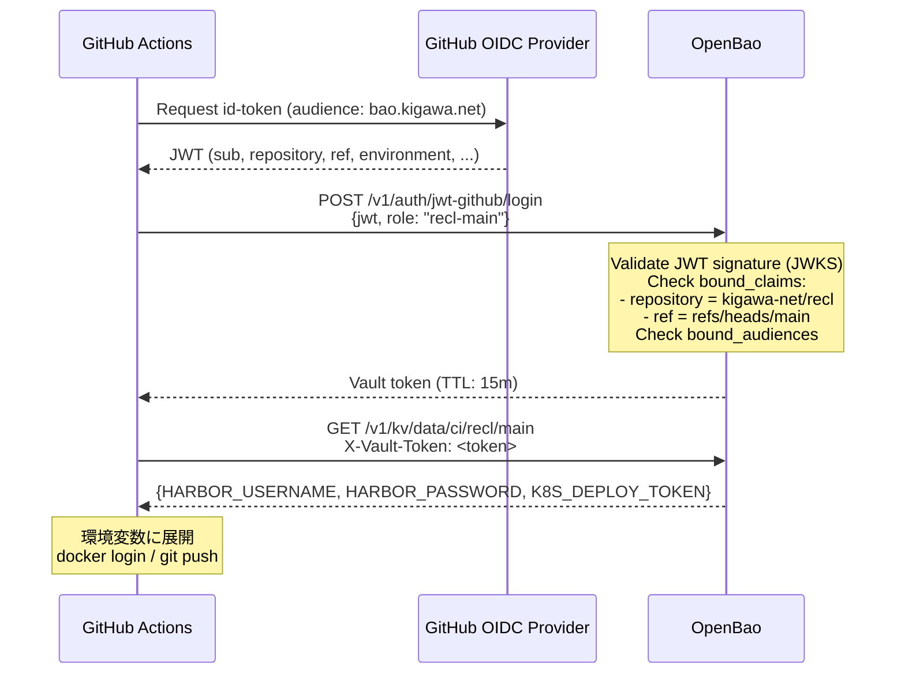

# recl CI シークレット供給の OpenBao 化設計

> **Status: design only, not implemented.** このドキュメントは設計のみ。deploy.yml を含め、既存ファイルは変更しない。

Date: 2026-11-07

## 関連

- リポジトリ: [kigawa-net/recl](https://github.com/kigawa-net/recl)
- 関連リポジトリ: [kigawa-net/infra](https://github.com/kigawa-net/infra)（OpenBao ノード構築）、[kigawa-net/kigawa-net-k8s](https://github.com/kigawa-net/kigawa-net-k8s)（OpenBao の K8s マニフェスト）
- 関連設計: `infra/docs/openbao-implementation-design.md`（OpenBao 実装設計、Phase 2 未完）
- トラッキング Issue: [recl #77](https://github.com/kigawa-net/recl/issues/77)（設計）
- 前提 Issue: [infra #469](https://github.com/kigawa-net/infra/issues/469)（OpenBao Phase 2 認証基盤の設計）

---

## 1. 背景と現状

### deploy.yml の失敗理由

recl の CI（`.github/workflows/deploy.yml`）は、main ブランチへの push で以下を実行する。

1. **シークレット事前チェック**: `HARBOR_USERNAME`、`HARBOR_PASSWORD`、`K8S_DEPLOY_TOKEN` の 3 つの GitHub Repository Secrets を環境変数に展開し、1 つでも空なら即 fail（fail-closed）。
2. **テスト**: `gradle test`（Java 21、Gradle 9.6.0）
3. **イメージのビルドと push**: `harbor.kigawa.net/kigawa-net/recl:<commit SHA>` を docker/build-push-action で push
4. **GitOps 更新**: `kigawa-net/kigawa-net-k8s` の `recl/deployment.yaml` のイメージタグを sed で書き換えて push（`K8S_DEPLOY_TOKEN` を使用）

現在、これら 3 つの GitHub Repository Secrets が未設定のため、ステップ 1 で失敗する。

### Bitwarden Secrets Manager の現行運用

Harbor の資格情報は Bitwarden Secrets Manager（BWS）に既に存在する。

| 項目 | 値 |
|------|-----|
| Organization ID | `a2b57f3d-6e2b-4467-b499-b31e00bfd804` |
| Harbor user の Secret ID | `929d361e-e599-4b58-b173-b3e201004d0a` |
| Harbor pass の Secret ID | `13c66d3b-7eb6-4c37-b466-b3e2010057b1` |

Kubernetes 内では、`kigawa-system/secret-provider/harbor-bws.yaml`（`BitwardenSecret` CRD）が BWS から取得し、`harbor-sync-crn.yaml`（CronJob、5 分ごと）が各 Namespace に `docker-registry` Secret として配布している。

### OpenBao の現状（Phase 2 未完）

OpenBao は 3 ノード Raft クラスタで稼働中。

| ノード | 配置 | アドレス |
|--------|------|----------|
| bao-01 | Inuyama K8s（StatefulSet） | `https://bao01.kigawa.net:8200`、cluster: `10.0.0.245:8201`（MetalLB VIP） |
| bao-02 | IONOS VPS（systemd） | WireGuard `172.31.254.30`、EasyTier `10.250.0.1` |
| bao-03 | host-hye1（systemd） | WireGuard `172.31.254.31`、EasyTier `10.250.0.31` |

TLS は Let's Encrypt DNS-01（Cloudflare）で発行。K8s 側は cert-manager、systemd 側は certbot。

**Phase 2（認証と監査）が未完のため、以下が未確定:**

- GitHub Actions から OpenBao API への到達経路（Cloudflare Access / Tunnel / self-hosted runner）
- JWT Auth の具体的な設定（`bound_audiences` の値など）
- KV v2 のマウントパスとパス規約の確定

infra の設計ドキュメント（`openbao-implementation-design.md`）は「ステータス: ドラフト（未着手、issue 未作成）」。

---

## 2. 目標アーキテクチャ

### 概要

GitHub Actions の OIDC id-token を使い、OpenBao の JWT Auth でログインし、KV v2 から CI 用シークレットを取得する。

```
┌─────────────────────────────────────────────────────────────────────────────┐
│                           GitHub Actions Runner                             │
├─────────────────────────────────────────────────────────────────────────────┤
│  1. OIDC id-token 取得                                                      │
│     └─ ACTIONS_ID_TOKEN_REQUEST_URL / ACTIONS_ID_TOKEN_REQUEST_TOKEN        │
│                                                                             │
│  2. OpenBao JWT Auth login                                                  │
│     └─ POST /v1/auth/jwt-github/login { jwt, role }                         │
│                                                                             │
│  3. KV v2 read                                                              │
│     └─ GET /v1/kv/data/ci/recl/main                                         │
│                                                                             │
│  4. 環境変数に展開して後続ステップで使用                                    │
└─────────────────────────────────────────────────────────────────────────────┘
          │
          │ (到達経路: §6 で検討)
          ▼
┌─────────────────────────────────────────────────────────────────────────────┐
│                              OpenBao Cluster                                │
│  ┌─────────────┐  ┌─────────────┐  ┌─────────────┐                          │
│  │   bao-01    │  │   bao-02    │  │   bao-03    │                          │
│  │  (K8s Pod)  │  │ (systemd)   │  │ (systemd)   │                          │
│  └─────────────┘  └─────────────┘  └─────────────┘                          │
│                                                                             │
│  auth/jwt-github  ─────▶  Policy: ci-recl-main  ─────▶  kv/data/ci/recl/*   │
└─────────────────────────────────────────────────────────────────────────────┘
```

### シーケンス図



---

## 3. OpenBao 側に必要な設定

### 3.1 JWT Auth Method

```hcl
# auth/jwt-github のマウント（GitHub Actions 専用）
path "auth/jwt-github" {
  type = "jwt"
}
```

**設定値:**

| パラメータ | 値 | 備考 |
|-----------|-----|------|
| `oidc_discovery_url` | `https://token.actions.githubusercontent.com` | GitHub の OIDC Discovery エンドポイント |
| `bound_issuer` | `https://token.actions.githubusercontent.com` | |
| `default_role` | （なし） | 明示的な role 指定を強制 |

### 3.2 Role: `recl-main`

```hcl
# platform/openbao-config/roles/jwt-github-recl-main.tf
resource "vault_jwt_auth_backend_role" "recl_main" {
  backend   = vault_jwt_auth_backend.github.path
  role_name = "recl-main"
  role_type = "jwt"

  user_claim            = "sub"
  bound_audiences       = ["bao.kigawa.net"]  # ※ 未確定。Phase 2 で確定
  bound_claims = {
    repository = "kigawa-net/recl"
    ref        = "refs/heads/main"
  }
  bound_claims_type     = "string"

  token_policies        = ["ci-recl-main"]
  token_ttl             = 900   # 15 分
  token_max_ttl         = 900
  token_no_default_policy = true
}
```

**設計判断:**

| 項目 | 判断 | 理由 |
|------|------|------|
| `bound_audiences` の値 | `bao.kigawa.net`（案） | 他の JWT 発行先と混同しないための識別子。Phase 2 で確定 |
| `environment` claim の使用 | **使用しない**（案） | recl は現時点で GitHub Environments を使っていない。将来 staging 環境を分ける場合は別 Role を作成 |
| `ref` の制限 | `refs/heads/main` に固定 | main 以外からのデプロイを許可しない |
| `sub` の glob | **使用しない** | infra 側設計方針に従う（`sub` は `repo:kigawa-net/recl:ref:refs/heads/main` の形式だが、glob ではなく `bound_claims` で個別に検証） |

### 3.3 Policy: `ci-recl-main`

```hcl
# platform/openbao-config/policies/ci-recl-main.hcl
# recl の main ブランチ CI 用。読み取りのみ、書き込み不可

path "kv/data/ci/recl/main" {
  capabilities = ["read"]
}

path "kv/metadata/ci/recl/main" {
  capabilities = ["read"]
}
```

**CI に管理権限を与えない:** Policy や Auth の設定変更権限は一切付与しない（infra 設計方針 §5）。

### 3.4 KV v2 のパス設計

infra 設計のパス規約に従い、CI 用は以下を提案。

```
kv/
└── data/
    └── ci/
        └── recl/
            └── main      # recl の main ブランチ用
                ├── HARBOR_USERNAME
                ├── HARBOR_PASSWORD
                └── K8S_DEPLOY_TOKEN
```

**注意:** `K8S_DEPLOY_TOKEN` は `kigawa-net/kigawa-net-k8s` への push 権限を持つ GitHub PAT または GitHub App Installation Token。この値自体を OpenBao で動的に発行することは現時点では対象外（GitHub App の Credential Broker は Phase 5/6 の範囲）。

---

## 4. recl 側 deploy.yml の変更案

### 4.1 id-token 権限の追加

```yaml
permissions:
  contents: read
  id-token: write  # 追加: GitHub OIDC token の取得に必要
```

### 4.2 シークレット取得ステップ

既存の「Verify deploy credentials are configured」ステップを以下に置き換える。

```yaml
- name: Fetch secrets from OpenBao
  id: secrets
  env:
    BAO_ADDR: ${{ vars.BAO_ADDR }}  # https://bao.kigawa.net:8200 など
    BAO_ROLE: recl-main
    BAO_PATH: kv/data/ci/recl/main
  run: |
    set -euo pipefail

    # 1. GitHub OIDC token の取得
    if [ -z "${ACTIONS_ID_TOKEN_REQUEST_URL:-}" ]; then
      echo "::error::OIDC token request URL not available. Check permissions.id-token setting."
      exit 1
    fi

    JWT=$(curl -sSfL \
      -H "Authorization: bearer ${ACTIONS_ID_TOKEN_REQUEST_TOKEN}" \
      -H "Accept: application/json; api-version=2.0" \
      "${ACTIONS_ID_TOKEN_REQUEST_URL}&audience=bao.kigawa.net" \
      | jq -r '.value')

    if [ -z "$JWT" ] || [ "$JWT" = "null" ]; then
      echo "::error::Failed to obtain OIDC token from GitHub"
      exit 1
    fi

    # 2. OpenBao JWT Auth login
    LOGIN_RESPONSE=$(curl -sSfL \
      --request POST \
      --data "{\"jwt\":\"${JWT}\",\"role\":\"${BAO_ROLE}\"}" \
      "${BAO_ADDR}/v1/auth/jwt-github/login")

    BAO_TOKEN=$(echo "$LOGIN_RESPONSE" | jq -r '.auth.client_token')
    if [ -z "$BAO_TOKEN" ] || [ "$BAO_TOKEN" = "null" ]; then
      echo "::error::Failed to authenticate to OpenBao. Check role configuration and bound_claims."
      exit 1
    fi

    # 3. KV v2 からシークレット取得
    SECRETS=$(curl -sSfL \
      -H "X-Vault-Token: ${BAO_TOKEN}" \
      "${BAO_ADDR}/v1/${BAO_PATH}")

    HARBOR_USERNAME=$(echo "$SECRETS" | jq -r '.data.data.HARBOR_USERNAME')
    HARBOR_PASSWORD=$(echo "$SECRETS" | jq -r '.data.data.HARBOR_PASSWORD')
    K8S_DEPLOY_TOKEN=$(echo "$SECRETS" | jq -r '.data.data.K8S_DEPLOY_TOKEN')

    # 4. 取得確認（fail-closed）
    missing=()
    for name in HARBOR_USERNAME HARBOR_PASSWORD K8S_DEPLOY_TOKEN; do
      if [ -z "${!name:-}" ] || [ "${!name}" = "null" ]; then
        missing+=("$name")
      fi
    done
    if [ "${#missing[@]}" -gt 0 ]; then
      echo "::error::Missing secrets from OpenBao: ${missing[*]}"
      exit 1
    fi

    # 5. マスクして後続ステップに渡す
    echo "::add-mask::${HARBOR_USERNAME}"
    echo "::add-mask::${HARBOR_PASSWORD}"
    echo "::add-mask::${K8S_DEPLOY_TOKEN}"

    {
      echo "HARBOR_USERNAME=${HARBOR_USERNAME}"
      echo "HARBOR_PASSWORD=${HARBOR_PASSWORD}"
      echo "K8S_DEPLOY_TOKEN=${K8S_DEPLOY_TOKEN}"
    } >> "$GITHUB_ENV"
```

### 4.3 移行期間の feature flag

完全移行までの間、GitHub Secrets と OpenBao の両方をサポートする選択肢。

```yaml
- name: Fetch secrets
  env:
    USE_OPENBAO: ${{ vars.USE_OPENBAO }}  # "true" or ""
    # GitHub Secrets（移行期間中のフォールバック）
    GH_HARBOR_USERNAME: ${{ secrets.HARBOR_USERNAME }}
    GH_HARBOR_PASSWORD: ${{ secrets.HARBOR_PASSWORD }}
    GH_K8S_DEPLOY_TOKEN: ${{ secrets.K8S_DEPLOY_TOKEN }}
  run: |
    if [ "$USE_OPENBAO" = "true" ]; then
      # OpenBao から取得（上記のスクリプト）
      ...
    else
      # GitHub Secrets を使用（既存動作）
      if [ -z "${GH_HARBOR_USERNAME:-}" ]; then
        echo "::error::HARBOR_USERNAME not set"
        exit 1
      fi
      echo "HARBOR_USERNAME=${GH_HARBOR_USERNAME}" >> "$GITHUB_ENV"
      # ... 以下同様
    fi
```

**移行完了後:** `USE_OPENBAO` の分岐を削除し、GitHub Secrets も削除する。

---

## 5. 到達経路の設計

GitHub Actions の runner から OpenBao API（`:8200`）に到達させる方法の比較。

### 前提条件

- OpenBao の `:8200` / `:8201` は **WireGuard 内のみで待ち受け**（設計方針。`ufw` で wg0 / EasyTier tun0 のみ許可）。公開 IP に直接 bind しない。
- Phase 2 の API 公開経路設計が未確定。

### 選択肢の比較

| 選択肢 | 概要 | 長所 | 短所 | 推奨 |
|--------|------|------|------|------|
| **A. Cloudflare Access + Service Token** | Cloudflare Tunnel で OpenBao を公開し、Access Policy で Service Token を要求 | runner 側の設定が最小限（HTTP ヘッダのみ）。tunnel の出口は WireGuard 内なので、ノードの公開 IP を晒さない | Cloudflare に依存。Service Token の管理が必要（GitHub Secrets に Service Token を入れることになり、完全な脱 GitHub Secrets にはならない） | △ |
| **B. WireGuard 内の self-hosted runner** | WireGuard に参加した self-hosted runner から直接 OpenBao にアクセス | ネットワーク的にシンプル。追加の認証層が不要 | self-hosted runner のホスト管理が必要。runner の脆弱性が OpenBao への直接アクセスに繋がる | × |
| **C. Cloudflare Tunnel（Access なし、JWT のみ）** | Tunnel で公開し、OpenBao 自身の JWT Auth のみで認証 | Service Token の管理が不要（GitHub OIDC + OpenBao JWT Auth で完結） | tunnel のエンドポイントが誰でもアクセス可能（OpenBao の Auth が唯一の防御線）。DDoS / brute-force の懸念 | △ |
| **D. Cloudflare Access + WARP to Tunnel** | runner で cloudflared または warp を起動し、Access 経由でトンネル接続 | Access の認証と OpenBao の認証の二重防御 | runner ごとに cloudflared のセットアップが必要。ステップが増える | ○（推奨案） |

### 推奨: D（Cloudflare Access + WARP to Tunnel）

**理由:**

1. **二重防御**: Cloudflare Access（Service Token）+ OpenBao JWT Auth で、万一片方が突破されてもシークレット漏洩に至らない。
2. **ノードの公開 IP を晒さない**: tunnel の出口は WireGuard / EasyTier オーバーレイ内に配置できる。
3. **GitHub Secrets の削減**: Service Token は GitHub Secrets に残るが、シークレットの本体（Harbor 認証、K8S_DEPLOY_TOKEN）は OpenBao に移る。

**トレードオフ:**

- runner で cloudflared のセットアップが必要。
- Cloudflare のサービス可用性に依存。

**未確認:**

- Phase 2 で Cloudflare Access / Tunnel の具体的な構成が決まるまで、この設計は仮置き。
- cloudflared のバージョン固定とアップデート戦略。

---

## 6. 移行手順

### Phase A: 準備（Phase 2 完了前に可能）

1. **OpenBao 側:**
   - `auth/jwt-github` マウントの作成（`platform/openbao-config`）
   - `oidc_discovery_url` の設定
   - Policy `ci-recl-main` の作成
   - KV パス `kv/ci/recl/main` の作成

2. **Bitwarden から OpenBao への値移送:**
   - Harbor 資格情報を BWS から OpenBao KV にコピー
   - `K8S_DEPLOY_TOKEN` を OpenBao KV に登録（現在どこに保管されているか未確認）

3. **到達経路の設定:**
   - Cloudflare Tunnel / Access の設定（Phase 2 の成果物を利用）

### Phase B: staging 検証

1. recl に staging 用の workflow（`deploy-staging.yml` など）を作成し、`USE_OPENBAO=true` で OpenBao 取得を試験。
2. 取得成功を確認後、staging 環境へのデプロイ（docker push + GitOps 更新）を 1 回実行。

### Phase C: 本番移行

1. `vars.USE_OPENBAO` を `true` に設定。
2. main ブランチへの push で本番デプロイが成功することを確認。
3. GitHub Repository Secrets から `HARBOR_USERNAME` / `HARBOR_PASSWORD` / `K8S_DEPLOY_TOKEN` を削除。
4. deploy.yml から feature flag の分岐を削除。

### Phase D: 二重管理期間の終了

1. BWS 側の Harbor 資格情報を削除（OpenBao が唯一の source of truth）。
2. ドキュメント更新。

### 切り戻し

- OpenBao 障害時は、GitHub Repository Secrets に値を再登録し、`vars.USE_OPENBAO` を削除またはリネーム。
- Phase C 完了後に切り戻す場合は、Bitwarden から値を取り出す（OpenBao のスナップショットからも可能）。

---

## 7. セキュリティ要件

| 要件 | 対策 |
|------|------|
| CI に OpenBao 管理権限を与えない | Policy は `kv/data/ci/recl/main` の `read` のみ。`sys/*`、`auth/*` へのアクセス不可 |
| 最小権限の Policy | ワイルドカード（`kv/data/ci/*`）を使わず、ブランチごとに別 Role / Policy |
| トークン TTL は短命 | `token_ttl = 900`（15 分）。workflow の実行時間内で完結 |
| 値を Actions ログに出力しない | `::add-mask::` で mask。curl のレスポンスをファイルに書かず、パイプで jq に渡す |
| GitHub OIDC の sub 検証 | `bound_claims` で `repository` と `ref` を個別に検証。`sub` の glob パターンは使わない |
| 監査ログ | OpenBao の audit device（file + syslog）で全リクエストを記録。`auth/jwt-github/login` の失敗・成功を追跡可能 |
| bound_audiences の固定 | 他サービス向けの JWT を誤って受け入れないよう、専用の audience 値を設定 |

---

## 8. 未解決点と依存

| 項目 | 状態 | 依存先 |
|------|------|--------|
| Phase 2 の API 公開経路設計 | **未確定** | infra `openbao-implementation-design.md` |
| `bound_audiences` の具体的な値 | **未確定** | Phase 2 完了時に決定 |
| Cloudflare Access Service Token の管理場所 | **未確定** | 到達経路の選択に依存 |
| `K8S_DEPLOY_TOKEN` の現在の保管場所 | **未確認** | 調査が必要 |
| bao CLI のバージョン固定 | **未検討** | runner で bao CLI を使う場合に必要。curl のみなら不要 |
| OpenBao 管理 token の入手経路（初期設定用） | **未確定** | Phase 2 の OIDC 認証完了後は管理者 OIDC で取得 |
| ESO（External Secrets Operator）との連携 | **将来検討** | Phase 4（Kubernetes 統合）で対応。本設計では GitHub Actions のみ対象 |

---

## 9. 受け入れ条件

### 設計フェーズ

- [ ] この設計ドキュメントのレビュー完了
- [ ] infra の Phase 2（認証と監査）が完了し、API 公開経路が確定
- [ ] `bound_audiences` の値が確定

### 実装フェーズ

- [ ] `auth/jwt-github` マウントと Role `recl-main` が作成されている
- [ ] Policy `ci-recl-main` が適用されている
- [ ] KV パス `kv/ci/recl/main` に 3 つの値が登録されている
- [ ] 到達経路（Cloudflare Tunnel / Access）が設定されている

### 検証フェーズ

- [ ] staging 環境で 1 回のデプロイ（docker push + GitOps 更新）が成功
- [ ] Actions ログにシークレットの値が出力されていない（`***` でマスクされている）
- [ ] OpenBao の audit log に `auth/jwt-github/login` の成功が記録されている
- [ ] `bound_claims` のバリデーション: main 以外のブランチからの workflow 実行が `permission denied` で失敗する

### 本番移行フェーズ

- [ ] `vars.USE_OPENBAO=true` での本番デプロイが成功
- [ ] GitHub Repository Secrets から 3 つの値を削除
- [ ] 切り戻し手順をドキュメント化

---

## 10. 関連ドキュメント

- [recl deploy.yml](../.github/workflows/deploy.yml) — 現在の CI 定義
- [infra/docs/openbao-implementation-design.md](https://github.com/kigawa-net/infra) — OpenBao 実装設計（Phase 2 以降）
- [infra/docs/openbao-restore.md](https://github.com/kigawa-net/infra) — 復旧手順と break-glass
- [kigawa-net-k8s/openbao/](https://github.com/kigawa-net/kigawa-net-k8s) — K8s 上の OpenBao マニフェスト
